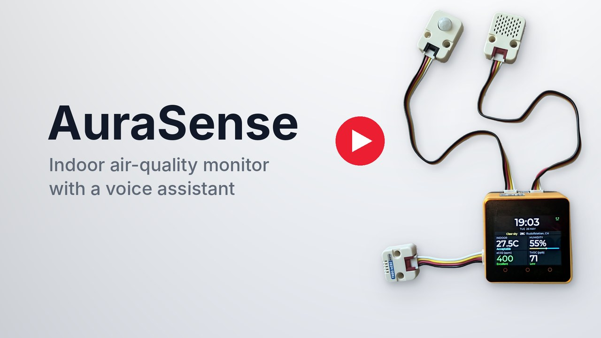
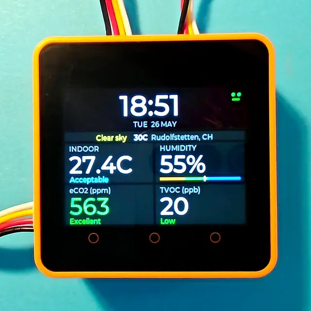
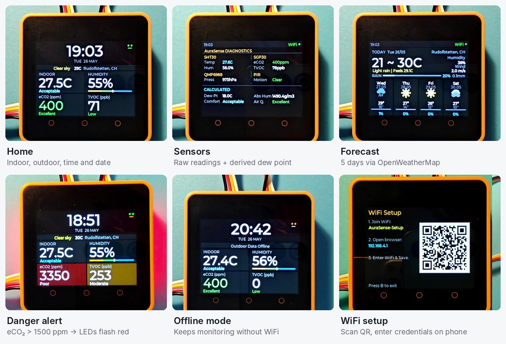
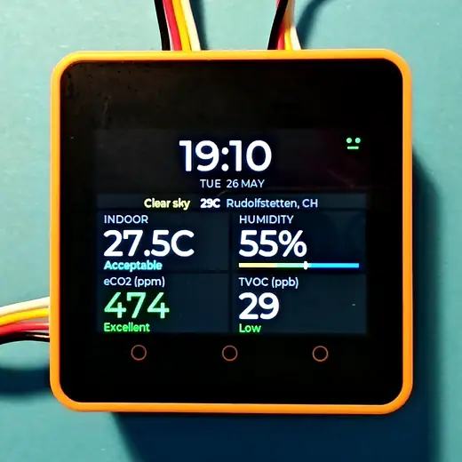
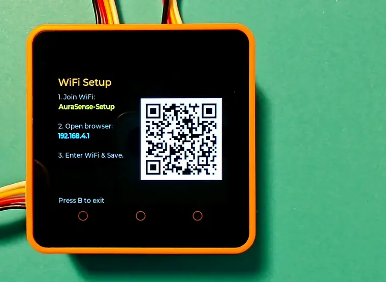
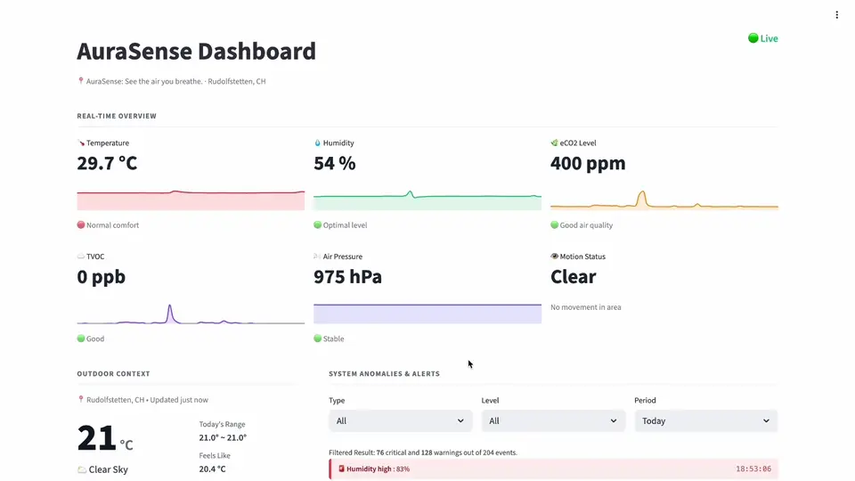
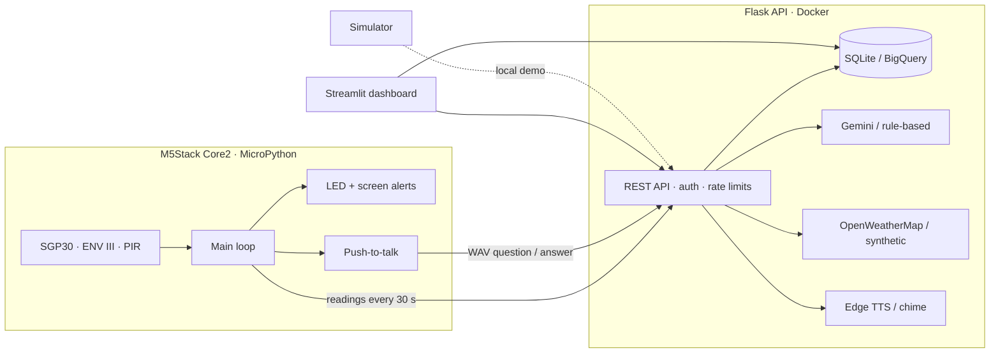
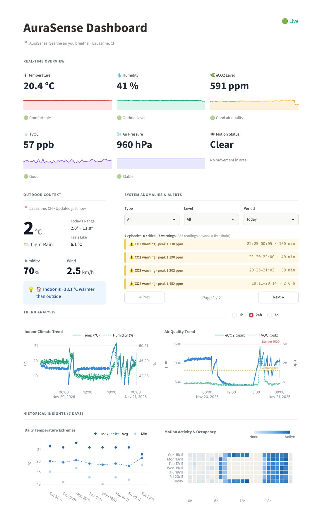
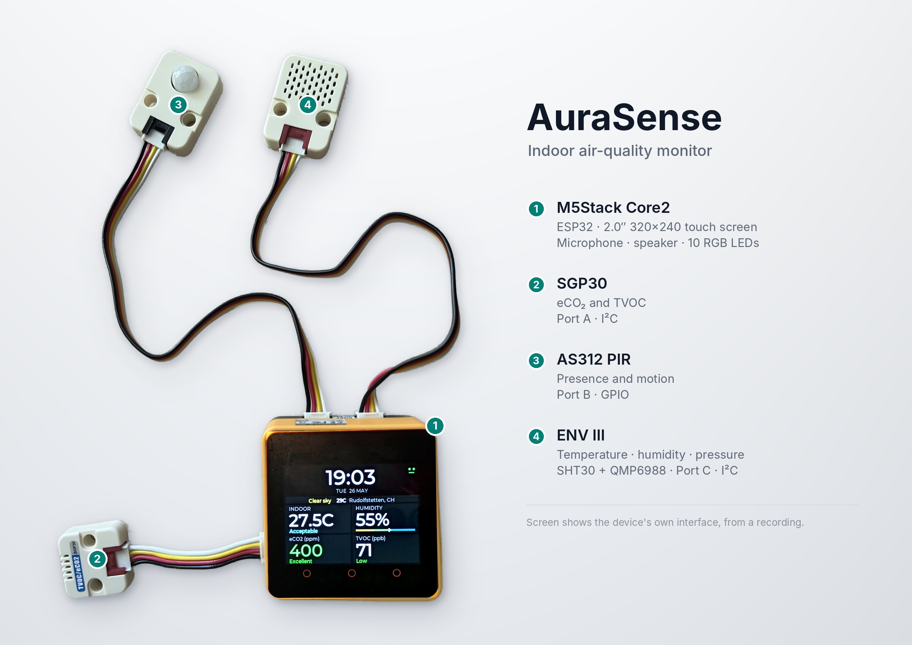

# AuraSense

[](https://github.com/embarky/AuraSense-M5StackCore2/actions/workflows/ci.yml)


[](LICENSE)

**See the air you breathe.** An end-to-end IoT system that measures indoor air quality on an ESP32 device, raises light and voice alerts when the air gets bad, answers spoken questions with an LLM, and keeps the history in the cloud for a web dashboard.

<p align="center">
  <a href="https://www.youtube.com/watch?v=Kg4_3pkiIR8"></a>
  <br><sub><b>▶ Watch the 70-second product video</b> — real device, real voice alerts and assistant answers, English subtitles.</sub>
</p>

<p align="center">
  <a href="https://www.youtube.com/watch?v=Kg4_3pkiIR8"><b>▶ Product video</b></a> ·
  <a href="#quick-start">Quick start</a> ·
  <a href="docs/design.md">Design document</a> ·
  <a href="docs/user-manual.pdf">User manual</a>
</p>

---

## Highlights

- **Edge to cloud, end to end** — MicroPython firmware on an M5Stack Core2, a Flask API, BigQuery storage and a Streamlit dashboard, deployed with Docker on Google Cloud.
- **Alerts that work offline** — temperature, humidity, pressure, eCO₂, TVOC and motion read every 3 s; two-level LED alerts are decided on the device, and spoken alerts fire after 10 s at danger level, even with the screen off.
- **Voice assistant** — hold a button and ask; Gemini transcribes and answers in one multimodal call with the last 24 hours of data as context, and Edge TTS speaks the reply (≈6–8 s round trip, measured on the device).
- **Runs anywhere with one command** — `docker compose up` starts the backend, dashboard and a physics-based virtual device. No hardware, API keys or cloud account needed.
- **Tested down to the firmware** — 89 automated tests, including firmware tests executed on the MicroPython interpreter; CI builds the images and checks the full demo on every push.

## The device

<p align="center">
  
  <br><sub>A gas source near the sensor pushes eCO₂ above 3,000 ppm; the reading turns red and the LED bar flashes.</sub>
</p>

<p align="center"></p>

| Voice assistant | WiFi setup from a phone |
|:---:|:---:|
|  |  |
| Hold **C** to record → *Uploading…* → *Playing…* (sound in the video) | Scan the QR code, enter credentials, the device restarts and connects |

## The dashboard

<p align="center"></p>
<p align="center"><sub>The deployed dashboard during the course (May 2026), showing a week of real readings.</sub></p>

## Architecture



Every external dependency sits behind a provider that configuration can switch between the real service (cloud deployment) and an offline stand-in (local demo). Details, API and design decisions: **[docs/design.md](docs/design.md)**.

## Quick start

```bash
git clone https://github.com/embarky/AuraSense-M5StackCore2.git
cd AuraSense-M5StackCore2
docker compose up --build
```

Open **http://localhost:8501**. A virtual device backfills 7 days of history and then streams live readings, so every panel is populated within about a minute.

<details>
<summary>What the local demo looks like and how the simulator works</summary>
<br>
<p align="center"></p>

The simulator models one room: a CO₂ mass balance driven by a two-person weekday/weekend routine, ventilation and window opening, cooking-related TVOC, heating set-points and humidity sources. It also reproduces a property of the real sensor: the SGP30 reports *estimated* eCO₂, which reads high when VOCs are present. Scenarios: `mixed` (default), `normal`, `stuffy`, `dry` — set `SIM_SCENARIO` in `.env`. Export a CSV without running the stack:

```bash
python simulator/aurasense_sim.py export --days 7 --out readings.csv
```

| Part | Local demo | Cloud deployment |
|------|-----------|------------------|
| Device | `simulator/` | M5Stack Core2 |
| Storage | SQLite (Docker volume) | Google BigQuery |
| AI advice & voice | Rule-based | Google Gemini |
| Weather | Synthetic | OpenWeatherMap |
| Speech | Chime | Edge TTS |
</details>

### Running on the real device

The device works with the local Docker stack too, with no cloud account needed. [docs/device-setup.md](docs/device-setup.md) covers flashing UIFlow 2, configuring `config.py`, uploading the firmware and troubleshooting.

### Cloud deployment with the real device

1. Copy `.env.example` to `.env` and fill in the "Cloud deployment" values (API key, GCP project and service-account key, Gemini and OpenWeatherMap keys).
2. `docker compose -f docker-compose.yml -f docker-compose.gcp.yml up -d --build`, behind an HTTPS reverse proxy for public access.
3. Flash and configure the Core2: [docs/device-setup.md](docs/device-setup.md).

Step-by-step instructions, routine tasks and a decommissioning checklist: [docs/operations.md](docs/operations.md).

## Hardware

<p align="center"></p>

| Port | Unit | Measures |
|------|------|----------|
| A (I²C) | SGP30 | eCO₂, TVOC |
| B (GPIO) | AS312 PIR | Motion |
| C (I²C) | ENV III (SHT30 + QMP6988) | Temperature, humidity, pressure |

**Controller:** M5Stack Core2 for AWS IoT EduKit — ESP32, 320×240 touch screen, microphone, speaker, 10 RGB LEDs. Firmware: UIFlow 2.0 v2.4.4 (MicroPython).

| Alert | eCO₂ | TVOC | Humidity | LEDs |
|---|---|---|---|---|
| Warning | > 800 ppm | > 220 ppb | < 30 % or > 65 % | yellow, 500 ms flash |
| Danger | > 1500 ppm | > 660 ppb | < 20 % or > 75 % | red, 250 ms flash + voice |

The screen dims after 60 s and turns off after 120 s without motion. Readings are uploaded every 30 s, every 5 s during an alert.

## Engineering challenges

The interesting problems appeared only after the device had been running for a while. Full write-up in [design.md §6](docs/design.md#6-engineering-challenges).

| Symptom | Root cause | Fix |
|---|---|---|
| Sensors stopped refreshing after NTP sync | Work was scheduled with the wall clock, which jumped when the real date was set | Monotonic `ticks_ms()` for scheduling; wall clock only for display |
| Uploads failed after about an hour | ESP32 network stack exhausted by half-open sockets | Guaranteed socket cleanup, `Connection: close`, software watchdog |
| Crash after playing speech | Audio buffers filled the limited RAM | Release buffers and collect garbage after playback |
| Dashboard flickered between Live and Offline | Two server processes each held their own copy of the live state | One process with threads and a lock |
| Weather for the wrong place | Behind Docker the server saw an internal IP, not the device's | Use the forwarded public IP, discard private ranges |
| Clock one hour off in winter | Firmware hard-coded UTC+2 | DST-aware offset sent by the backend |

## Repository layout

```
device/        MicroPython firmware: sensors, pages, connectivity, alerts
backend/       Flask API: routes/, storage/ (SQLite, BigQuery), services/ (Gemini, TTS, weather, mocks)
dashboard/     Streamlit dashboard: BigQuery and SQLite data sources, charts
simulator/     Physics-based virtual device for demos and tests
tests/         backend, dashboard, simulator and MicroPython firmware tests
docs/          design document, device setup, operations guide, user manual
assets/        images and recordings used in this README
```

## Development and testing

```bash
pip install -r backend/requirements.txt pytest && pytest tests/backend
pip install -r dashboard/requirements.txt pytest && pytest tests/dashboard tests/simulator
tests/device/run_device_tests.sh        # needs micropython + mpy-cross
```

| Suite | Covers |
|-------|--------|
| `tests/backend` (52) | Authentication and rate limiting, ingestion and batch validation, query bounds, per-device voice history, storage, provider selection |
| `tests/dashboard` (23) | Anomaly rules and episode grouping, comfort level, and every dashboard view on a database filled by the simulator |
| `tests/simulator` (9) | Physical plausibility, occupancy patterns, scenarios, determinism |
| `tests/device` (5) | Firmware compiled with the MicroPython compiler and executed on MicroPython with the hardware modules stubbed |

[CI](.github/workflows/ci.yml) runs ruff, a gitleaks secret scan and all suites on every push, then builds the Docker images and checks that `docker compose up` delivers simulated data to the dashboard. Install the pre-commit secret scan locally with `pip install pre-commit && pre-commit install`.

## Project history

| Version | When | What |
|---|---|---|
| **v1.0** | May 2026 | Course project (team of two): firmware, Flask backend, BigQuery, Streamlit dashboard, deployed on Google Cloud and demonstrated on the device. Cloud resources were shut down after the course. |
| **v2.0** | Nov 2026 | Post-course work by Hang Yang: security clean-up (API authentication, secrets removed from history), concurrency, timezone and query fixes, pluggable providers with a one-command local demo, device simulator, 89 tests and CI, documentation. |

See [CHANGELOG.md](CHANGELOG.md). Known limitations, such as eCO₂ being an estimate rather than an NDIR CO₂ measurement, are listed in [design.md §9](docs/design.md#9-limitations-and-future-work).

## Team

v1.0 was built by **Hang Yang** and **Yi Huang** as a course project for *Cloud and Advanced Analytics* at the University of Lausanne (2026). The post-course work in v2.0 is by Hang Yang.

## Acknowledgements

- Hardware provided by the course *Cloud and Advanced Analytics*, University of Lausanne.
- Built on [UIFlow 2](https://uiflow2.m5stack.com/) and the M5Stack unit drivers, [Flask](https://flask.palletsprojects.com/), [Streamlit](https://streamlit.io/), [edge-tts](https://github.com/rany2/edge-tts), [OpenWeatherMap](https://openweathermap.org/) and [ip-api](https://ip-api.com/).
- **AI assistance:** AI coding assistants were used during development — in v1 to help refactor the device and backend code, and in v2 as a pair programmer (Claude) for the security fixes, local demo, tests and documentation. Commits written with AI assistance carry a `Co-Authored-By` trailer.

## License

Released under the [MIT License](LICENSE) © 2026 Hang Yang and Yi Huang.
