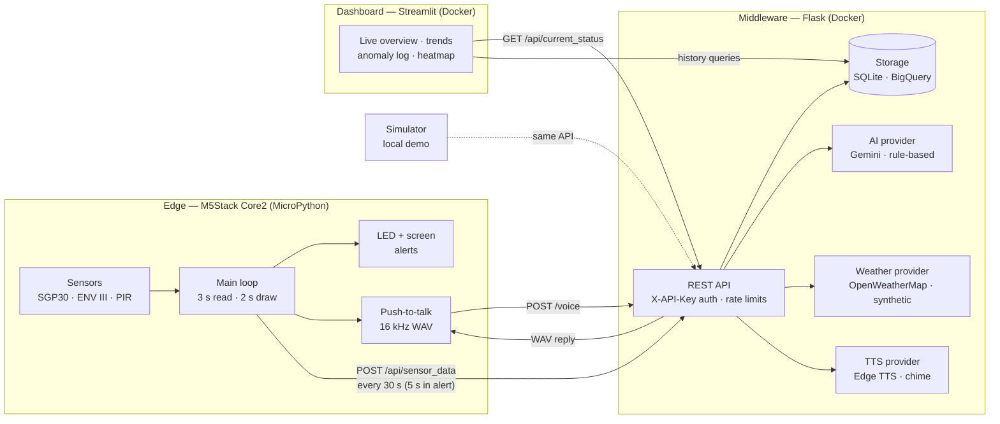

# AuraSense — Design Document

*An end-to-end IoT system for indoor air-quality monitoring with real-time alerts and an AI voice assistant.*

| | |
|---|---|
| **Author** | Hang Yang (v1 was a course project with Yi Huang) |
| **Context** | Cloud and Advanced Analytics, University of Lausanne, spring 2026 |
| **Status** | v1 deployed on Google Cloud during the course (May 2026), then decommissioned. v2 runs locally with one command; cloud deployment is an optional override. |

---

## 1. Problem

People spend most of their time indoors, yet CO₂, volatile organic compounds and humidity are invisible: nobody notices when a bedroom becomes stuffy overnight or a kitchen fills with cooking fumes. AuraSense makes indoor air visible and actionable: a device in the room shows the readings, warns with lights and speech when the air gets bad, and answers questions; a web dashboard lets you check the home remotely and look back over days.

## 2. Requirements

The course brief fixed the hardware (M5Stack Core2, ENV III, an air-quality sensor, a PIR motion sensor) and the core cloud services. The table maps each requirement to how it is met.

| # | Requirement (from the brief) | Implementation |
|---|---|---|
| R1 | Device shows outdoor temperature, indoor temperature/humidity, air quality, time/date via NTP, multi-day forecast | Home, Sensors and Forecast pages; NTP sync; 5-day forecast from OpenWeatherMap via the backend |
| R2 | Alerts on the device when humidity is low or air quality is bad | Two-level LED alerts (warning/danger) on the 10-LED bar plus spoken alerts at danger level (§5.6) |
| R3 | Presence-triggered announcements, at most hourly | PIR sets screen state; hourly spoken summary only when someone has been active recently |
| R4 | Speech-to-text and text-to-speech; questions about current and past data | Push-to-talk voice assistant: Gemini (audio in) + Edge TTS (audio out), with a 24-hour data summary in the prompt |
| R5 | All readings stored in BigQuery | Streaming inserts into a BigQuery table (v2: behind a storage interface, §5.7) |
| R6 | Cloud dashboard in Streamlit reading historical data | Dashboard with live overview, trends (1 h / 24 h / 7 d), daily aggregates, motion heatmap, anomaly log |
| R7 | Survive power loss and lost connectivity; WiFi changeable by the user | Offline mode (sensors, LEDs, screen keep working), automatic recovery, QR-code WiFi setup |
| R8 | 3-tier architecture, abstracted configuration, deployable by someone else | Device / Flask middleware / data + UI tiers; configuration in files and environment variables; Docker Compose |

Non-functional goals added in v2: no secrets in the repository; authenticated API; reproducible builds; runs without hardware, keys or cloud costs; automated tests including the firmware.

## 3. Architecture

**Tiers.** The device owns sensing, display and alerting and keeps working offline. The backend is the only component that talks to external services; it stores readings, enriches them with outdoor weather and runs the AI features. The dashboard reads live state from the backend and history directly from the store.

**Data flow of one reading.** The device reads every sensor every 3 s and uploads every 30 s (every 5 s while an alert is active, immediately when a danger alert fires). The backend stores the reading, refreshes the cached outdoor weather for the device's location, starts a background AI-advice job at most every 10 minutes, and replies with outdoor conditions and the DST-aware UTC offset, which the device uses for its clock.

**Voice request.** The device records while button C is held, uploads the WAV file, and plays the WAV reply. The backend sends the audio and a 24-hour data summary to Gemini in one multimodal request, extracts the transcript and answer from the structured reply, synthesises speech and resamples it to the 16 kHz mono format the Core2 speaker expects. Measured on the device, a round trip took about 6–8 seconds.

## 4. API

| Method | Path | Purpose |
|---|---|---|
| POST | `/api/sensor_data` | One reading from the device; returns weather, local time, UTC offset, latest advice |
| POST | `/api/sensor_data/batch` | Up to 1,000 timestamped readings (simulated history, offline buffering) |
| GET | `/api/current_status` | Latest snapshot for the dashboard |
| GET | `/api/history?hours=` | Raw readings, 1–168 h |
| GET | `/api/aggregates?days=` | Daily aggregates, 1–90 days |
| GET | `/api/forecast` | 5-day forecast for the device's location |
| POST | `/voice` | WAV question → WAV answer |
| POST | `/speak`, `/alert` | Hourly announcement, danger alert → WAV |
| POST | `/reset` | Clear this device's conversation history |
| GET | `/health` | Liveness (unauthenticated) |

Every endpoint except `/health` requires the `X-API-Key` header; `X-Device-Id` identifies the device.

## 5. Design decisions

Each decision lists the choice, the main alternative, and the consequences we accept.

### 5.1 HTTP polling from the device, not MQTT
**Choice.** The device POSTs JSON over HTTP and gets everything it needs (weather, time offset, advice) in the response.
**Alternative.** MQTT with a broker would give push messaging and lower overhead per message.
**Consequences.** One protocol, no broker to run, and the backend stays a plain web API that the dashboard and simulator also use. The cost is that the backend cannot push to the device; anything the device needs arrives with its next upload, at most 30 s later. On the ESP32 each HTTP request needs careful socket handling (§6.2).

### 5.2 Gemini for speech recognition and answering in a single call
**Choice.** The recorded audio is sent directly to a multimodal Gemini model, which is asked to return the transcript on the first line (`HEARD: …`) and the answer below it.
**Alternative.** A separate speech-to-text service followed by an LLM call.
**Consequences.** One network round trip and one API instead of two. The model's output format must be parsed defensively; if the `HEARD:` line is missing, the whole reply is used as the answer.

### 5.3 Edge TTS for speech output
**Choice.** Microsoft's Edge neural voices via the `edge-tts` package, resampled with ffmpeg to 16 kHz mono 16-bit WAV.
**Consequences.** Natural voices in many languages without an API key. It depends on an unofficial endpoint, which is why v2 also has an offline provider (§5.7).

### 5.4 Location from the device's public IP
**Choice.** The backend geolocates the device's public IP (ip-api.com) and uses the coordinates for OpenWeatherMap.
**Consequences.** No GPS or manual setup. Behind Docker or a reverse proxy the backend first sees an internal address; private, loopback and link-local addresses are therefore discarded, and the configured fallback city is used (§6.4).

### 5.5 One worker process with threads
**Choice.** Gunicorn runs one worker with eight threads.
**Context.** The latest device snapshot and the per-device conversation histories are held in process memory. With several worker processes each request could land in a process with a different copy (§6.5).
**Consequences.** Shared state is consistent and guarded by locks. Throughput is limited to one process, which is ample for a few devices; scaling out would require moving this state to a shared store such as Redis.

### 5.6 Two-level alerts, decided on the device
| Level | eCO₂ | TVOC | Humidity | LEDs | Speech |
|---|---|---|---|---|---|
| Warning | > 800 ppm | > 220 ppb | < 30 % or > 65 % | yellow, 500 ms flash | — |
| Danger | > 1500 ppm | > 660 ppb | < 20 % or > 75 % | red, 250 ms flash | after 10 s, then every 30 s |

**Choice.** Thresholds are evaluated on the device, so LED alerts work without a network. Spoken alerts start only after the danger level has persisted for 10 seconds, which filters out short spikes, and they repeat every 30 s while it lasts, even with the screen off.
**Consequences.** Alerting does not depend on the cloud. The same thresholds are duplicated in firmware and dashboard (`dashboard/anomalies.py`), so they must be changed together. The dashboard groups consecutive readings beyond a threshold into episodes (readings less than 5 minutes apart belong to one episode) and lists each episode once, with its duration and peak, rather than one entry per reading.

### 5.7 Pluggable providers and a local demo (v2)
**Choice.** Storage (SQLite / BigQuery), AI (rule-based / Gemini), weather (synthetic / OpenWeatherMap) and speech (chime / Edge TTS) are selected by configuration. Defaults follow the credentials that are present, so an existing cloud configuration keeps the real services and an empty one runs fully offline. A physics-based simulator replaces the device.
**Why.** The cloud deployment cost money while running and was shut down after the course; the hardware went back. Without this, nobody, including reviewers, could run the project.
**Consequences.** `docker compose up` runs the full system with no hardware, keys or cloud account. The dashboard has a second implementation of its history views (pandas over SQLite) that must return the same columns as the BigQuery queries; tests enforce this.

### 5.8 Security model (v2)
A shared API key on every endpoint (constant-time comparison), per-client rate limits on the endpoints that call paid APIs, generic error messages, no secrets in the repository or Docker images, and a gitleaks scan in CI. HTTPS is expected to be terminated by a reverse proxy in any public deployment. A shared key is adequate for a single household; per-device credentials would be the next step.

## 6. Engineering challenges

| # | Symptom | Root cause | Fix |
|---|---|---|---|
| 6.1 | After NTP sync the device stopped refreshing sensors | The main loop scheduled work with the wall clock (`time.time()`), which jumped when NTP set the real date | Scheduling uses the monotonic `ticks_ms()` / `ticks_diff()`; the wall clock is used only for display |
| 6.2 | Uploads started failing after about an hour | The ESP32 network stack ran out of memory/sockets (ENOMEM / ENOBUFS) because of half-open connections | Sockets always closed in `finally`, `Connection: close`, stale WiFi state cleared at boot, and a software watchdog that reboots after memory errors or 15 consecutive failures |
| 6.3 | Device crashed after playing speech | WAV buffers stayed in the limited RAM | Buffers released and `gc.collect()` after every playback |
| 6.4 | Weather showed the wrong place or none | Behind Docker the backend saw the bridge IP instead of the device's | Use the forwarded public IP and discard private addresses (v2: proper `ipaddress` checks — the original `172.` prefix test also matched public addresses) |
| 6.5 | Dashboard flickered between "Live" and "Offline" | v1 raised the timeout from 60 s to 120 s. v2 found the root cause: two gunicorn workers each held their own in-memory snapshot | One worker with threads and a lock (§5.5) |
| 6.6 | Pressure could not be read | The ENV III driver in use did not match UIFlow 2 | Switched to UIFlow 2's ENV unit driver |
| 6.7 | v2: clock one hour off in winter | Firmware added a fixed UTC+2 (summer time) | The backend returns the DST-aware offset; firmware falls back to a configurable value |
| 6.8 | v2: a quote in a WiFi password would stop the device booting | The setup page wrote credentials into `config.py` without escaping | Values written with `repr()`; covered by a MicroPython test |
| 6.9 | v2: API keys in git history | An early commit contained a configuration file with real keys | Keys revoked, history rewritten, gitleaks in pre-commit and CI |

## 7. Verification

* **Automated tests (89)** — backend (52), dashboard (23), simulator (9), firmware (5, run on the MicroPython interpreter with the M5Stack modules stubbed, plus compilation of every firmware file with `mpy-cross`). The v2 fixes that can be reproduced in a test (§6.4, §6.7, §6.8 and the API issues in §5.8) were each re-introduced to confirm that a test fails; the multi-worker issue (§6.5) is a deployment property and is addressed by configuration.
* **CI** — lint, secret scan, all test suites, Docker image builds, and an end-to-end check that `docker compose up` delivers simulated data to the dashboard.
* **Hardware** — v1 was tested on the device throughout the course (see the [product video](https://www.youtube.com/watch?v=-8rTBZ_OiJc)). v2 firmware changes are small and covered by the MicroPython tests, but have not been re-run on hardware.

## 8. Operations and cost

The v1 deployment ran on a Google Compute Engine VM with Docker Compose. Running costs came from the VM, BigQuery streaming inserts and storage, and Gemini API calls (bounded by the 10-minute advice cooldown and the voice rate limit). OpenWeatherMap and Edge TTS were free at this scale. After the course the cloud project was shut down to stop costs. The readings were not exported first, so the original data is lost; the lesson, now part of the [operations checklist](operations.md), is to export data before decommissioning anything.

## 9. Limitations and future work

* **eCO₂ is an estimate.** The SGP30 infers "equivalent CO₂" from hydrogen and VOC signals; it is not an NDIR CO₂ measurement and reads high when VOCs are present. Validating it against an NDIR reference sensor (e.g. SCD41) is the most valuable next experiment.
* **SGP30 calibration.** Humidity compensation and baseline persistence across reboots are not implemented.
* **Thresholds** come from the course design; they should be checked against published indoor-air guidance and documented with sources.
* **Single-household scope.** One shared API key; the UI assumes one device.
* **No store-and-forward.** Readings taken while offline are not uploaded later; the batch endpoint added in v2 is the server side of this feature.
* **AI answers are only as good as the context.** The voice assistant receives a 24-hour summary, so questions about a specific earlier time can be answered imprecisely. Letting the model query the data through tool calls, and measuring answer accuracy, is planned.

## 10. Reflection

The hardest problems were not features but long-running behaviour on a constrained device: clocks that jump, sockets that leak, memory that fragments. They only appeared after the system had run for an hour, which is why v2 invests in tests, a simulator and CI. The second lesson was operational: shutting down a cloud deployment is part of its lifecycle and needs a checklist, starting with exporting the data.
